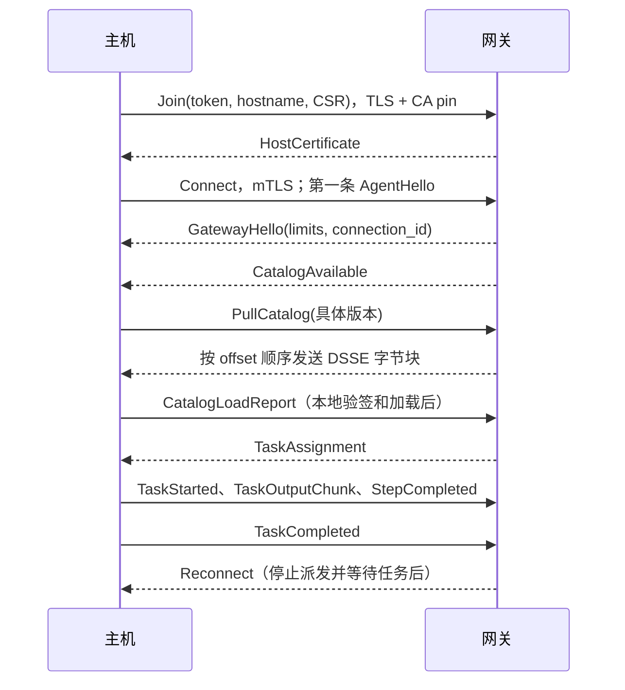

# allowops v1 协议

## 协议选择与依据

本文与 `.proto` 是 P2 的确定实现契约，不是服务实现。依据为 `9952ee8457bd5ba61099837ae6d8775d0670bf26` 的 `docs/architecture-decisions.md` 第 21 节，以及总指挥在 P2 第三轮传达的 G10、G15。原 Q1～Q10 的问题编号保留用于追溯，决定来源见下表。

| 问题 | 候选方案 | 选择及依据 |
|---|---|---|
| 参数原值 | `Struct` 浮点数、字符串 map、JSON 字节 | JSON 对象字节；保留整数精度、布尔值、数组和缺省，适配内置处理器，避免把错误类型强制转换为字符串 |
| 目录包 | 重建 protobuf 对象、原始 DSSE 字节 | 原始 DSSE（Dead Simple Signing Envelope）字节；签名载荷不能因传输重编码而变化 |
| 输出 | UTF-8 string、bytes | bytes；保留非 UTF-8 输出及哈希。界面只按不可信纯文本展示 |
| 大对象传输 | 全部塞入连接流、独立 RPC | task 输出在连接流分块；目录拉取独立服务端流；控制台上传/下载用一元分页，避免浏览器客户端流限制 |
| 零值与默认值 | 隐式零值、显式存在性 | 对等待时间、失败阈值、有效期使用 optional，区分未传与显式 0；枚举 0 为 UNSPECIFIED |
| 身份 | 主机名即身份、不可变 ID | 证书绑定不可变 host_id，主机名用于展示和选择；删除再注册产生新 ID，旧证书失效 |
| 离线任务 | 重连补发、不补发 | offline，不排队，恢复不补发；执行中断线终止进程组，不重放、不补传（design §2、A9） |
| 新于网关的版本 | 比主版本、比完整 SemVer | 按 SemVer 2.0 比较完整版本，拒绝比网关新的主机端（G10） |

## 已确定

负责人决定 A9～A14、A17 见[决定记录第 21 节](architecture-decisions.md#21-实施期间确认的行为a7a28)。G10、G15 为总指挥决定，来源是本轮任务说明；决定记录第 21 节说明 G 系列记录在计划库。

| 原问题 | 决定来源 | 实现契约 |
|---|---|---|
| Q1 传输与分页限额 | G10 | 按第 6 节表中的默认值实施，全部可配置；Hello 返回连接限额，系统状态公布 API 限额。数值需规模测试验证，未验证不影响当前契约生效 |
| Q2 执行中断线 | A9 | 主机终止进程组，task 标记 offline，不重放、不补传；已发生的副作用不保证撤销 |
| Q3 CSV 与批量标签 | A10、A14 | 全部原子提交，显式 set/remove；预览默认 10 分钟有效，目标变化重新预览；selector 只支持逗号分隔的 key=value 合取 |
| Q4 策略与多目录 | A11 | 结构化规则、base_version 乐观并发；多个目录的 action 名全局唯一，发布冲突拒绝 |
| Q5 OIDC CLI 交付 | G10 | 一次性 code + PKCE 交换会话 token，CLI 回环仅接 code/state |
| Q6 用户角色与 CLI 会话 | A12；本轮对两个 RPC 的明确要求 | 组映射可由控制台/API 修改并存数据库；手工角色与映射角色取并集；用户操作自己的会话，admin 可指定用户列出并吊销会话 |
| Q7 版本比较 | G10 | 按 SemVer 2.0 比较完整版本，拒绝比网关新的主机端，仍只支持当前及上一主版本 |
| Q8 步骤输出与过滤 | A13、A17 | max_output 为所有步骤 stdout+stderr 总预算；退出码取首个失败步骤，否则 0；过滤分别作用于每步 stdout；tail/head/count 互斥，match/exclude 可与其中之一组合；max_scan 按每步 stdout 原始字节计 |
| Q9 发布与审计字节 | G10 | 分块上传后原子发布；审计返回权威 hash_input 规范字节，验证使用原字节 |
| Q10 默认时长 | A14 | 主机证书 24h、单次 join token 24h、CSV 预览 10min、上传暂存 1h，均可配置 |
| 跨实例路由 | G15 | 有界临时消息表保存路由消息，NOTIFY 只带消息 ID；P4 实现，不增加主机协议字段 |
| 续证与既有连接 | G18 | 既有 Connect 流保留到新连接替代或原证书到期；新握手及后续 RPC 要求当前证书；删除立即断开全部既有流 |

## 1. 文件、服务和调用边界

所有文件使用 `syntax = "proto3"`、包 `allowops.v1`、Go 包 `github.com/liubing0806/allowops/gen/allowops/v1;allowopsv1`。只依赖本包和 Protobuf 标准 `Timestamp`、`Duration`。`version.proto` 和 buf 配置沿用 P0；Go 消息和 Connect 绑定通过仓库的 `make generate` 生成。

| 文件 | 服务 | RPC 与用途 |
|---|---|---|
| `common.proto` | 无 | 分页、目标、目录引用、参数、过滤、状态、结果、错误详情 |
| `agent.proto` | `AgentService` | `Join` 注册；`RenewCertificate` 续证；`Connect` 双向连接；`PullCatalog` 拉取签名目录包 |
| `host.proto` | `HostService` | `ListHosts`/`GetHost` 查询；`SetHostLabels` 批量改授权标签；`PreviewHostImport` 创建 CSV 预览、`GetHostImportPreview` 分页读预览、`ExecuteHostImport` 提交；`DeleteHost` 删除并使证书失效 |
| `host.proto` | `JoinTokenService` | `CreateJoinToken` 创建并一次返回 secret；`ListJoinTokens` 元数据；`RevokeJoinToken` 吊销 |
| `catalog.proto` | `CatalogService` | `BeginCatalogUpload`/`UploadCatalogChunk` 暂存；`PublishCatalog` 验签和发布；`ListCatalogs` 历史；`GetCatalog` 元数据；`ListActions`/`GetAction` action 展示；`GetCatalogDistribution` 主机加载版本分布 |
| `policy.proto` | `PolicyService` | `GetPolicy` 当前/历史；`TestPolicy` 试算；`GetPolicyTestChanges` 变化分页；`SavePolicy` 保存；`ListPolicyHistory` 历史；`RollbackPolicy` 以历史规则产生新版本 |
| `identity.proto` | `ServiceAccountService` | `CreateServiceAccount`/`GetServiceAccount`/`ListServiceAccounts`/`UpdateServiceAccount` 账号管理；`CreateServiceAccountToken`/`ListServiceAccountTokens`/`RevokeServiceAccountToken` token 管理 |
| `identity.proto` | `UserService` | `ListUsers`/`GetUser`；`SetUserRoles` 手工角色；`ListRoles` 角色名；`GetRoleMappings`/`SaveRoleMappings` 组映射 |
| `identity.proto` | `AuthService` | `GetLoginMethods`；`BeginOidcLogin`/`CompleteOidcLogin`；`LoginLdap`；`ExchangeCliSession`；`GetCurrentSession`/`Logout`；`ListCliSessions`/`RevokeCliSession` |
| `job.proto` | `JobService` | `RunJob` 提交；`GetJob`/`ListJobs` 摘要；`ListTasks` 主机结果；`ListTaskSteps` 步骤结果；`CancelJob` 取消；`GetJobOutput` 输出字节分页 |
| `audit.proto` | `AuditService` | `ListAuditEvents` 查询；`ExportAudit` 分页 JSON Lines；`VerifyAudit` 哈希链校验 |
| `system.proto` | `SystemService` | `GetSystemStatus` 概览、依赖健康和限额；`ListGatewayInstances` 实例；`GetAgentVersionDistribution` 主机端版本分布 |

`AgentService.Connect` 只走 gRPC 双向流，浏览器不调用它。其他控制台和 CLI RPC 均为 Connect 一元请求。主机主动发起全部主机侧 RPC；不增加网关到主机的监听端口。443 上的 TLS ALPN 路由如下，不在 protobuf 中复制网络配置。

P4 的 443 TLS ALPN（应用层协议协商）入口使用 TLS 1.3，L4 负载均衡透传：

| ALPN | 载荷及身份 | 路由 |
|---|---|---|
| `allowops-join/1` | HTTP/2，服务端 TLS 身份及 join token | 只允许 AgentService.Join |
| `allowops-agent/1` | HTTP/2 标准 gRPC，内部 CA mTLS | RenewCertificate、Connect、PullCatalog；拒绝 Join |
| `allowops-mcp/1` | HTTP/2，用户认证由后续节点实现 | MCP 占位 handler |
| `h2`、`http/1.1` | 标准 HTTPS；控制台/CLI 用户认证由后续节点实现 | `/mcp`、`/mcp/` 为 MCP 占位，其余为 API 占位 |
| 未提供 ALPN | HTTPS HTTP/1.1 | 同标准 HTTPS 入口；不允许主机 RPC |

浏览器使用标准 HTTPS ALPN，通过路径区分 MCP 与控制台。主机客户端必须设置相应自定义 ALPN；HTTP/2 客户端可用自定义 TLS dialer 保留它。任何已提供但不支持的 ALPN 在握手时拒绝。主机证书不能获得 API/MCP 权限。P4 的占位 handler 返回 HTTP 501。

除注册和登录入口外，所有 RPC 先认证，再按 ABAC（基于属性的访问控制）判定。主机证书只可访问主机服务；不会因持有主机证书获得控制台权限。API token 和 CLI 会话通过 `Authorization: Bearer` 传递，控制台通过安全 Cookie；token 不作为查询参数。API 不能修改主机信任的目录签名密钥。

## 2. 共用消息与编码

- `CatalogRef` 为 `catalog_id + version`；版本为 UTC `YYYYMMDDHHMMSS` 的 `uint64`。主机拉取、任务下发和报告必须引用具体版本。控制台只读目录查询中 version=0 表示该 ID 当前版本；不允许用于执行。`RunJob` 的 action 名由网关解析为当前目录的唯一 action，job 中记录解析后的引用和摘要。多个目录的 action 名全局唯一，发布冲突时拒绝（A11）；客户端不能任意选旧目录执行。
- `Parameters.json` 是 UTF-8 JSON 对象原始字节，缺省字段保持缺省；无参数传 `{}`。主机收到的是调用者参数，不是渲染后的 argv。网关与主机均依签名 schema 校验，再应用目录默认值。不得经过 `map[string]float64` 或 JavaScript Number 往返后称为“原值”。拒绝重复键、非对象、尾随数据和超限嵌套；最大深度默认 32，可配置（G10）。参数错误的原值可能含秘密，不写到错误详情或日志。
- `OutputFilters` 用 optional 保留 presence。允许项来自签名 action 的 `filters`，`match`/`exclude` 为 RE2 且最长 200 字符；stdout 顺序为脱敏、过滤、截断。stderr 也先脱敏再截断。tail、head、count 按字段存在性互斥，同时传入返回 INVALID_ARGUMENT；match/exclude 可与其中之一组合（A17）。max_scan 按每个步骤 stdout 原始字节计；扫描超限使用 `scan_limit_reached`，不能混同 `truncated`。
- 输出、摘要、CSR（证书签名请求）和证书均为 bytes；CSR/证书内容为 PEM。SHA-256 字段固定 32 字节，缺省表示尚不可用，不表示空内容的摘要。所有 duration 必须非负；有执行上限含义时必须大于 0。时间为 UTC `Timestamp`。
- `HostTargets` 必须设置 oneof：非空主机名列表或 selector。selector 只支持逗号分隔的非空 `key=value` 条件，所有条件均须满足（A10），不支持 OR、正则或集合操作。HostTargets 的空 selector 不构成合法目标，返回 INVALID_ARGUMENT；查询列表未指定 selector 表示不加该筛选。`reported.` 前缀仅用于上报标签筛选，未加前缀仅指授权标签。策略永远只读取授权标签。
- `PageRequest.page_token` 为不可解释的服务端游标，绑定身份、过滤器和稳定排序；后续请求不能改过滤条件。空 `next_page_token` 表示完成。排序：资源按不可变 ID，版本倒序，job 按创建时间及 ID 倒序，审计按 seq 升序。`ListJobs` 游标记录上一页最后一个 job 的创建时间和 ID，按该位置之后继续查询并逐个检查权限，直到填满页面；单次请求的数据库工作量随页大小和需跳过的不可见 job 数增长，不随游标之前的历史增长。权限仍在每次读取时检查，不把游标作为授权凭据。
- ProtoJSON 中 uint64 按字符串编码，bytes 按 Base64 编码，enum 按符号名编码。消费者不得假定 enum 总是已知值。`UNSPECIFIED` 不是业务成功；需要业务枚举的请求必须显式指定。规范中的 required 是服务校验要求，proto3 不使用 `required` 关键字。

## 3. 主机身份、连接和目录同步

### 注册与续证

1. 主机本地生成私钥和 CSR，先按本地配置的 `--ca-pin` 验证网关 TLS 身份，再发送 `JoinRequest`。注册无现成客户端证书认证，但仍校验 join token、次数、有效期和 CSR 签名。
2. 网关原子消耗 token 次数，检查全局唯一 hostname，生成不可变 host_id，并按网关批准的身份签证。不能直接信任 CSR 自填的主体、SAN 或授权标签。私钥不上传；响应不携带 CA 私钥。
3. `HostCertificate` 返回证书链、到期和建议续期时刻。证书期限默认 24h，可配置（A14）。主机只有上报标签，新注册主机没有授权标签并默认拒绝 action。
4. `RenewCertificate` 使用现存有效 mTLS 身份，仅可为同一 host_id 换 CSR。过期或已删除身份不能续期。删除主机必须断开现有连接，并使旧身份不能重连或续证；在每个网关实例检查身份有效性，不只依赖 TLS 证书时间。相同 hostname 重新注册获得新 host_id，旧证书不能因此恢复有效。

P4 的证书身份固定为 CN=`host_id` 和唯一 URI SAN `spiffe://allowops/hosts/{host_id}`，用途仅为客户端认证。CSR 中的主体、DNS/IP/URI SAN、扩展及授权属性全部不复制。数据库记录当前证书序列号；续证成功后新证书替换该序列号。G18 规定：既有 Connect 流保持原身份，直到新连接替代或原证书到期，续证不扩大原流有效期。新 TLS 握手和旧 TLS 会话的后续 RPC 都要求当前证书；旧证书不能建立新 Connect。既有流每秒检查主机有效状态，删除时通过 NOTIFY 立即断开，不等待证书到期。

`CreateJoinToken.max_uses` 必须大于 0，1 为单次，多次也有明确上限。多次 token 的 ttl 未传用 24h；显式非正值拒绝。单次 ttl 未传时使用配置默认值，默认 24h（A14）。安装命令由 CLI/控制台用返回的 upstream、ca_pin、secret 组装；只有创建响应含 secret，列表不重显。吊销只阻止新注册，不连带吊销已签发主机证书。

### 连接时序和身份绑定



首条主机消息必须为 `AgentHello`，服务端第一条必须为 `GatewayHello`；完成版本检查前不派发任务。`AgentHello` 上报软件 SemVer、支持的 schema 版本、参数类型、执行模式、内置处理器、过滤能力、附加 feature、上报标签和已加载目录。能力是声明，不替代主机本地校验。未知能力字符串可保留展示，网关不据此推断支持其他能力。

连接身份只来自 mTLS，消息不能指定其他 host_id；job/task 必须属于该连接身份已接收的任务。`GatewayHello.connection_id` 区分新旧连接，多实例路由需保证同一 host_id 只由当前连接接收任务。旧连接替换时的在途行为按 A9 处理，P4 应以连接代次校验消息。跨实例路由使用有界临时消息表，NOTIFY 只传消息 ID（G15）；消费端读取消息并校验主机连接代次，不把临时表作为离线任务队列，断线后不得重放或补传。

`AgentHeartbeat.sequence` 在每次新连接从 1 递增；网关返回同一序号。心跳计时使用接收侧单调时钟，`sent_at` 只用于诊断。心跳更新网关内存，连接/断开及每 5 分钟持久化 last_seen，遵循 design §8。

### 目录同步

连接后网关逐个发送当前目录的 `CatalogAvailable`；更新时同样通知。通知是拉取提示，不是加载成功。主机调用独立的 `PullCatalog`，offset 从 0 连续递增，eof 只出现在最后一块；每块重复具体 CatalogRef 和同一信封摘要。最后按完整信封校验长度及摘要，再验 DSSE 签名、schema、有效期、单调版本和 action 支持情况。网关摘要不替代本地签名信任。

拉取中断后从 0 重新拉取该不可变版本，不拼接不同版本。DSSE 字节保持原样；网关先验签，主机再次验签，allowops-exec 执行前再次验签。传输内容不含主机凭据。

`CatalogLoadReport` 中 `loaded=false` 表示目录整体拒绝；`loaded=true` 可以同时有不支持的 action。report_id 在连接内标识一次报告，page_index 从 0 连续递增，所有页的 catalog/loaded/reason 一致，最后页 final_page=true。网关在完整报告后替换支持状态；未完成报告不能算作加载成功。每页最多 100 个 unsupported action；未知 schema 整包拒绝，已知 schema 的不支持 action 单独报告。主机仍需在每次执行时验证摘要和本地条件。

## 4. 任务、输出和关闭

### 执行和取消

`TaskAssignment` 固定 job_id/task_id、目录版本、action 名和 SHA-256、参数原值、有效 timeout 和过滤参数。主机只从本地签名目录解析命令；网关不能扩大签名目录的 timeout、输出上限或过滤许可。摘要不匹配、执行模式不支持或命令不可用返回 `unsupported`。

一次连接内每个 task_id 最多执行一次；收到重复派发不得再次执行。协议不提供自动重放或 exactly-once 副作用保证。网关派发时主机离线：该 task 为 `offline`，不排队，恢复不补发。已开始的任务遭遇断线按 A9 终止进程组并标记 offline，不重放、不补传输出或结果；已经发生的副作用不能据此推断已撤销。

`TaskStarted` 是实际开始的确认，不是网关写出消息成功即视为开始。无法开始的任务可以直接回 `TaskCompleted`。终态只能完成一次，终态之后的输出或结果不得覆盖已完成记录。

`CancelJob` 阻止尚未开始批次，网关对运行任务发 `CancelTask`；主机结束整个进程组，再回 cancelled 终态。取消不是立即完成的保证；响应可仍为 running。已完成 job 的取消返回现状。取消与完成竞争时保留先确定的终态，不把 succeeded 改写为 cancelled。A9/A13 的实现须验证这些竞态。

### 输出分块和步骤结果（A13、A17）

- 不使用小结果内联、大结果另一套结构；所有输出均为 `TaskOutputChunk`。分块键为 `(task_id, step_index 的存在性和值, stream)`。非 steps 的 step_index 缺省；steps 从 0 开始，不能把缺省和步骤 0 混同。
- 每个键 offset 从 0 开始、连续递增，不接受重叠或空洞；eof 恰好一次。空输出发送 data 为空、offset=0、eof=true 的一块。只有 eof 块允许空 data，避免空块洪泛。
- 脱敏必须在分块前完成，不能按网络块独立匹配秘密。stdout 脱敏后过滤，再执行目录 max_output 截断，最后分块。gateway 仍按签名上限校验累计字节，不能相信主机填写的长度和 truncated 标记。
- 每个已执行步骤的 stdout/stderr eof 之后发送 `StepCompleted`，其中含步骤名、序号、退出码、耗时、截断和扫描超限标记。因 on_error=stop 未执行的后续步骤报告 skipped，exit_code 缺省、无输出。所有步骤报告后发送 `TaskCompleted`，completed_steps 是已报告步骤数（包括 skipped）。
- 非 steps 的 `TaskCompleted.result.stdout/stderr` 为其输出元数据；steps 的这两个字段缺省，避免再聚合一份重复输出。各步骤元数据由 `ListTaskSteps` 读取；task 的 truncated/scan_limit_reached 是各步骤对应标记的 OR，duration 为 action 总耗时。
- 最终退出码取首个失败步骤的退出码，否则取 0；若失败无进程退出码则缺省。action 的 timeout/run_as 由所有步骤共用，max_output 为所有步骤 stdout+stderr 的总预算（A13）。过滤分别应用于每个步骤的 stdout；max_scan 按每个步骤 stdout 原始字节计，不能共用整个 action 的扫描预算（A17）。
- `ExecutionResult.reason` 仅传稳定原因代码，例如 `ACTION_DIGEST_MISMATCH`、`CATALOG_EXPIRED`、`EXECUTABLE_MISSING`。stdout/stderr 不得放入 reason，避免通过 job 摘要绕过输出权限。

`OutputMetadata.sha256` 对该逻辑输出的全部已脱敏、过滤、截断后的 bytes 计算。步骤任务的输出组可按有序步骤的退出码及 stdout/stderr 摘要比较；MCP 聚合逻辑在 P6 实现，不需要再定义可绕过权限的摘要输出字段。

### 网关优雅关闭

网关先停止接收新任务并停止向当前连接派发，等待执行中任务结束，再发送 `Reconnect`。`close_at` 是本连接关闭时刻；retry_after_min/max 给出随机抖动范围。主机只重连本地配置的 upstream，消息不接受任意新地址或 CA。超过关闭时限仍有任务时按 A9 处理；不把网络关闭等同显式取消成功。重连退避默认范围 1～30s，可配置（G10），需与 60s 全部重连验收目标一起验证。

## 5. 控制台和 CLI API 语义

### 主机和 CSV（A10、A14）

`Host` 的 authorization_labels 可改，reported_labels 只读。`SetHostLabels` 只 set/remove 显式键，不覆盖未出现的键；同一键不能同时 set/remove。请求必须携带精确 expected_count 及每个目标的 expected_revision，以事务核对目标集合、权限与 revision。任一冲突不改任何主机。`ListHosts` total_count 是该调用者可见且符合查询的数量；标签计数超过限额时 label_counts_truncated=true，不能把截断计数当完整分布。

CSV 为 UTF-8 RFC 4180，首列 `hostname`，其余列为 `set:<key>` 或 `remove:<key>`。set 的空单元格表示空字符串；remove 单元格只允许 `true` 或空，空表示无操作。重复主机、未知主机、重复列、同键 set/remove 及非法标签均作为行错误。CSV 只导入已有主机的授权标签，不创建主机。

预览保存原始 CSV 摘要、调用者、目标 ID/revision 和 before/after；预览只读。`GetHostImportPreview` 分页读取。`ExecuteHostImport` 只提交绑定的预览，不再接收另一份 CSV；再次校验权限、目标存在和 revision，任一错误全部拒绝。预览有效期默认 10min，可配置（A14）；目标集合或 revision 变化、预览过期均须重新预览（A10）。set 允许空字符串值。对同一个已成功提交且尚在有效期内的预览重试，返回第一次的 updated_count，不重复覆盖后续编辑；仍需校验当前权限。

`DeleteHost` 通过不可变 ID 和 revision 定位，保留历史 job/task/审计关联，删除当前注册记录并失效其证书。对运行任务按 A9 处理，不能把删除解释成远端命令已经停止。

### 目录发布（G10、A11、A14）

`BeginCatalogUpload` 固定 envelope 长度与摘要、绑定发布者身份；`UploadCatalogChunk` 顺序写暂存区，offset 必须等于 next_offset。相同 offset、相同 bytes 的重试可返回同一 next_offset，不同内容返回 ABORTED。并发上传同一 upload_id 不允许交错内容。暂存有效期默认 1h，可配置（A14），不产生可见目录。

`PublishCatalog` 在全部字节收到后验证长度、摘要、DSSE 签名、schema、过期时间、版本单调性、action 命名及全局唯一性，然后原子设为当前版本并通知主机；不使用未验签的客户端元数据决定 catalog_id/version。相同 upload_id 成功后的重试返回相同 CatalogVersion；同一 catalog/version 但不同字节拒绝。失败不发布半个目录。

`CatalogVersion` 是元数据，`ActionSummary` 是列表摘要，`GetAction.definition_json` 为已验证目录定义的只读表示，含参数、执行方式和脱敏规则，供控制台展示；它不作为主机验签或执行输入。`ListActions`/`GetAction` 按当前身份可见权限过滤。`GetCatalogDistribution` 基于主机最后一次完整加载报告，尚未加载单独计数，离线主机保留其最后报告。

### 策略（A11）

`PolicyRule` 显式描述 role/team/owner、operation、action/risk、授权标签、hours 和 CIDR。operations 使用稳定名称：`execute_action`、`manage_policy`、`manage_service_accounts`、`manage_hosts`、`create_join_token`、`manage_users`、`publish_catalog`、`view_hosts`、`view_catalog`、`view_job`、`view_output`、`view_audit`、`view_system`；目录所述角色默认权限由 P5 规则数据实现，不在协议中硬编码角色绕过。

规则匹配：roles 必填且支持 `*`；其余非空主体条件合取，列表内为或；operations 必填；actions 与 risks 非空项之间为或，两者都空时不限制 action。host_labels 为逐键相等合取；CIDR 列表为或；hours 用明确 IANA 时区且 `0 <= from < to <= 24`，范围左闭右开，跨午夜用两条规则。主体属性由 P5 从身份库读取；主机条件只能匹配实际提供的主机授权标签，不能由调用者伪造。所有规则 deny 优先、无匹配 deny、求值异常 deny；新主机无授权标签时明确执行默认拒绝约束。

`TestPolicy` 用 rules 或 historical_version 作为候选，在 base_version 上试算；test_id 绑定候选摘要、操作者、当前主机/身份/目录快照及测试环境。cases 显式指定主体 ID、operation、action、targets、时间和 IP；服务器从身份库解析属性，不能由调用者伪造 roles。空 cases 为现有主体与可用 action 对现有主机的变化试算，并检查控制台关键操作；超出配置的试算资源限额返回 RESOURCE_EXHAUSTED，不能抽样后声称完整试算。变化由 `GetPolicyTestChanges` 分页返回。

保存和回滚都必须对应成功试算，重新确认 base_version、候选一致性、快照有效性及防锁死检查。状态变化返回 ABORTED，重新试算；不能用过期 test_id 绕过校验。配置中的 bootstrap_admins 始终保有修改策略权限。回滚不是降低版本号，而是复制历史规则生成更高版本，记录 rolled_back_from。试算期间没有业务执行副作用。

### 服务账号、用户和登录

服务账号的 name、owner_user_id、description、roles 及可选 teams 是主体属性。更新请求全量替换列出的可改属性，expected_revision 防止覆盖并发修改。token 为 `aops_` 前缀加 32 随机字节，只返回一次；存 SHA-256，默认 30 天，可选 1～365 天，过期前 7 天提醒。吊销后后续请求立即失效；列出 token 只含 ID、描述和时间，不返回明文或哈希。

用户由 OIDC（OpenID Connect）或 LDAP 登录创建/同步，不新增本地密码注册 API。`SetUserRoles` 只改 manual_roles，不允许提交 mapped_roles/effective_roles。有效角色取映射和手工角色并集（A12），每次授权读取当前身份属性；ListRoles 返回默认角色以及策略/身份中引用的角色名，不新增角色 CRUD 体系。role_mappings 可由控制台/API 修改并存数据库；数据库记录是运行时的权威来源（A12），配置启动值不能覆盖已保存的映射。

OIDC CLI 流程（G10）：BeginOidcLogin 创建服务端事务，生成 state/nonce；OIDC 授权码始终由网关兑换，并校验 issuer、audience、nonce、state 和配置的固定回调。CLI 注册精确的 loopback URI、自己的 state 和 S256 PKCE（Proof Key for Code Exchange）challenge；成功后只将短期一次性 code/state 发给该回环 URI，CLI 校验 state 后使用 code_verifier 调 ExchangeCliSession。PKCE verifier 和会话 token 不出现在跳转 URL。一次性 code 默认 60s 有效，消费原子且仅一次；URI 仅允许回环 IP 和本次登记端口，禁止任意外部跳转。

`CompleteOidcLogin` 供网关 HTTP 回调适配层处理；proto 不实现路由。控制台成功后用 `Secure; HttpOnly; SameSite=Strict` 会话 Cookie，响应体不含会话 token。登录事务必须绑定发起浏览器；跨站回调与 Strict Cookie 的结合方式（同源完成页再调用 Complete，或等效服务器事务绑定）由 P5 实现并验证，不能只凭 state 字符串接受任意浏览器登录。控制台写 RPC 校验 Origin 和会话绑定的 CSRF token；GetCurrentSession 返回该 CSRF token。

LDAP 密码仅经 TLS 发往网关，网关仅使用 LDAPS/StartTLS、转义过滤条件、限流且不保存密码。LoginLdap 的 client=CLI 才返回 cli_session_token，console 仅设置 Cookie。CLI 会话默认 7 天；本地 credentials 权限 0600。Logout 失效当前会话。ListCliSessions/RevokeCliSession 的 user_id 空值表示当前用户，非空表示精确指定的用户；普通用户只能指定自己，admin 可指定其他用户（A12 及本轮 RPC 要求）。服务端先检查跨用户权限，再查询或吊销目标用户的会话；RevokeCliSession 的 session_id 必须属于解析后的目标 user_id，不能凭其他用户的 session_id 绕过权限。ListCliSessions 的分页游标必须绑定解析后的 user_id。所有 secret/password/code/verifier 均排除请求日志、审计载荷和错误详情。

### job 与输出 API

RunJob 与 MCP 共用参数校验、目标解析、expected_count 检查、逐台 ABAC、批次调度和审计。selector 必须传 expected_count，不匹配返回实际数量；任一 deny 则整单拒绝，并返回被拒主机和规则，不派发部分任务。reason 必填。batch_size/max_failures 只能收紧 action/网关限制，未传时取 action 限制与网关 jobs 配置中的较小值（网关默认 20/5）；max_failures=0 表示首次失败即停止。wait_seconds 未传时取网关 jobs 配置（默认 30，最大 120），显式 0 为立即返回；MCP 工具 schema 中的 default 与 maximum 按同一配置生成；它只限制 RPC 等待，不改变 action 超时。RunJob 网络结果不明时不得盲目重试，协议没有新增幂等键；可按主体、action 和时间查询 job 后人工确认。

G39：RunJobRequest 新增字段 10、GetJobRequest 新增字段 3 为 `response_format`；RunJobResponse/GetJobResponse 新增字段 2 为 `JobSummary`，原字段保持编号和含义。缺省为 concise，每组至多返回前两个主机名；detailed 在响应预算内列出全部主机名。分组只比较退出码的存在性和值、stdout SHA-256、stderr SHA-256。每组 stdout+stderr 预览总计至多 4KiB，单次响应的 protobuf 和 JSON 编码均至多 32KiB。省略组、主机名或预览时 summary.truncated 为 true；group.truncated 表示预览或主机输出发生截断。输出信任标记固定 UNTRUSTED。Job 本身保持仅元数据；所有汇总预览仍需 view_output，缺少该权限时只返回元数据。

A21：服务账号只读取/取消自己的 job；读取自己的元数据和取消无需额外执行授权。控制台用户读取元数据需 view_jobs，取消时按原 action 对所有目标重新检查 execute_action，任一 deny 则拒绝。预览和完整输出另需 view_output。权限规则集中于 P6 authorize，SystemService job 计数复用它。A22：max_failures 统计 failed、timeout、unsupported，不统计 offline；集合常量集中于 failureStatuses。取消未下发任务标 cancelled；零目标拒绝；每日 job 序号为至少四位，可超过 9999（G39）。

A23：连接所属实例校验输出分块并在内存聚合，终态事务保存每个流至多 4KiB 的脱敏过滤预览、完整输出哈希和大小；预览列允许为空。调用实例通过 PreviewSource 读取预览并组装汇总。完整输出异步写对象存储，写入不阻塞响应。gateway_messages 始终只传路由消息和完成元数据。完整输出仅从对象存储读取，不从接收缓冲区提供读取。

G45：CLI 存在 --param 时通过 CatalogService.GetAction（catalog 可缺省）读取签名 schema，按类型编码整数、布尔和数组；无 view_catalog 或 action 不存在时返回错误。G46：P6 使用 SendToConnection 绑定保留的连接代次；有 deadline 的任务消息等待至 task deadline，原 Send、CancelTask 和其他临时消息仍受 MailboxTTL 限制。

Job/Task/ListTaskSteps 不携带 stdout/stderr 正文或原始参数。`GetJobOutput` 必须单独检查 view_output 并记录审计；经网关从对象存储代理读取，不能返回 S3 预签名 URL。输出按 `(job, host, step, stream)` 的字节 offset 分页，next_offset=offset+data.length；可能在 UTF-8 字符中间分块，客户端以流式解码显示纯文本。eof 表示完整逻辑输出已结束，不只是当前页为空。正在产生但该 offset 暂无数据时返回空页、eof=false；offset 超过当前可读范围返回 OUT_OF_RANGE。

output_trust 固定为 UNTRUSTED。truncated 说明主机保留的输出已经截断，并不意味着还有可读取的隐藏原始输出。output_stored 只表示异步持久化成功；false 不改变执行结果；数据库预览仍可查询。完整输出写入失败或对象已过期时返回 NOT_FOUND + `OUTPUT_UNAVAILABLE`，不能返回空输出并谎报 eof。P6 需区分正在写入和永久丢失，暂不可读可返回 UNAVAILABLE + retry_after。

对象路径使用不可变 host_id：`outputs/{yyyy}/{mm}/{dd}/{job_id}/{host_id}.{stdout|stderr}.zst`；steps 使用 `{host_id}.step-{零起始序号}.{stdout|stderr}.zst`，缺省步骤与步骤 0 不共用对象。S3 请求启用 AES256 服务端加密，校验和仅在协议需要时计算；网关解压时按已校验输出大小限制读取并核验 SHA-256。bucket 生命周期由运维配置。GetJobOutput 默认页为 16KiB，最多请求 24KiB，实际返回量可因 32KiB JSON 编码预算收紧。

G48：SystemService 的 running_jobs 统计 queued/running；failed_jobs_last_24_hours 统计最近 24 小时完成的 failed/partially_failed。两项均调用与 job 查询相同的授权函数，服务账号所有者限制沿用 A21。对象存储健康检查为超时 2 秒的 S3 HeadBucket，不读写业务对象，依赖错误只返回去敏状态。

G51：Drain 拒绝新 RunJob，等待本实例发起的 job 及本实例当前连接上的在途 task；不再下发剩余批次并标 skipped（GATEWAY_DRAINING）。关闭 deadline 后由 P4 按 A9 断开连接。

G52：job 保存 origin_instance。实例心跳超过与 SystemService 共用的失联阈值（max(2×FlushInterval, HeartbeatTimeout)）后，存活实例使用 job 行锁和 SKIP LOCKED 收尾：pending task 标 skipped，running task 标 failed，错误码 GATEWAY_INSTANCE_LOST。保留已经确定的终态，按常规汇总得出 job 终态并写审计。来源实例故障的批次恢复与重放尚未实现（L1）；收尾不保证远端任务已发生的副作用撤销。

A29 本地对象存储验证：SeaweedFS 4.46，固定镜像 `chrislusf/seaweedfs:4.46@sha256:08d516132314207d10c8e37cbffc1f32b147d870169688734cc61c6231625b62`。测试只通过本机 Docker socket 启动，端口绑定 127.0.0.1；S3 凭据与 SSE 密钥随机生成，不传入进程参数。aws-sdk-go-v2 的请求校验和与响应校验设为 WHEN_REQUIRED，实测压缩输出上传、读取、空输出及解压大小限制。AES256 需要配置 SeaweedFS SSE 密钥；未配置时实测 PutObject 返回 HTTP 500 InternalError。配置方式见 [SeaweedFS SSE 文档](https://github.com/seaweedfs/seaweedfs/wiki/Server-Side-Encryption)。

SeaweedFS 生命周期规则实测：PutBucketLifecycleConfiguration 接受 `outputs/` 前缀、Enabled、Expiration.Days=30，GetBucketLifecycleConfiguration 返回相同保留期。只证明规则配置 API 可用，未等待到期删除；部署者仍需验证目标版本的实际清理行为。默认一年保留期由 bucket 生命周期规则配置，网关不自动改 bucket 配置。详情见 [SeaweedFS S3 生命周期文档](https://github.com/seaweedfs/seaweedfs/wiki/S3-Lifecycle)。

### 审计和系统

`AuditQuery` 按半开时间区间 `[from,to)`、主体、主机、action、job 和 operation 筛选。AuditEvent 不含命令输出，只有输出路径/摘要、判定和策略版本。seq/prev_hash/hash 为审计链，checkpoint_seq/hash 对应每 5 分钟记录的链末尾。object_path 仅为审计元数据，读取仍走 GetJobOutput 权限和审计。

审计哈希（G10）为 `SHA256(prev_hash || hash_input)`，prev_hash 固定 32 字节；创世为 32 个零字节。hash_input 是 P7 持久化的权威 UTF-8 规范 JSON 载荷，包含 seq、时间、主体、操作、结果、输出引用、检查点（如有），不含自身 hash/prev_hash。proto 展示字段必须与载荷一致；验证不能用 ProtoJSON 重新序列化展示字段再算哈希。P7 负责生成并持久化规范字节，查询与导出必须返回相同字节；客户端只校验返回的 hash_input，不依赖本地 JSON 编码器。分区保留边界使用已有外部检查点或前序锚校验，缺少可验证边界时报告无法验证。

#### P7 规范字节与创世规则

`hash_input` v1 使用 UTF-8 JSON，固定成员顺序为 `version,seq,at,subject_id,operation,resource,decision,reason,matched_rules,source_ip,hostname,action,job_id,task_id,policy_version,outputs,checkpoint_seq,checkpoint_hash`。不含空白、BOM 或末尾换行。所有成员都出现。`version` 为数字 1；seq、policy_version、非空 checkpoint_seq 为无前导零的十进制字符串，范围不超过 PostgreSQL signed bigint。空 checkpoint_seq/hash 为 JSON null，空文本为 `""`，空规则和输出为 `[]`。字符串不做 Unicode 归一化，必须是有效 UTF-8。双引号、反斜线和控制字符按 Go encoding/json 的转义编码；控制字符使用其短转义（如 `\n`、`\t`），其余使用小写 `\u00xx`。U+2028/U+2029 编码为 `\u2028`/`\u2029`；`<`、`>`、`&` 和其他 Unicode 字符直接编码为 UTF-8，不做 HTML 转义。

at 由追加器分配，不接受调用者时间；UTC 时间截断到微秒，以 RFC3339Nano 编码（小数秒删除尾部零，无小数时省略，末尾 Z）。时钟回退时取链尾时间。来源 IP 为空或 netip 的规范地址文本，IPv4-mapped IPv6 转为 IPv4，拒绝 zone。matched_rules 按 UTF-8 字节字典序升序、去重。outputs 保持调用者顺序；每个输出的固定顺序是 `object_path,sha256,stream,step_index`，SHA-256 是 32 字节标准带 padding Base64，stream 为数字 1（stdout）或 2（stderr），step_index 为 uint32 数字或 null。所有输出只含引用和摘要。

没有独立的创世事件。未写入任何事件时 seq=0 是虚拟链锚，hash 为 32 个零字节，保存在 audit_boundary；第一条实际记录 seq=1，prev_hash 为零锚。每次追加在事务级 advisory lock 内取链尾 seq+1，不使用非事务 sequence；失败回滚不消耗 seq。检查点是 operation=`audit_checkpoint` 的实际事件，checkpoint_seq/hash 指向它之前的链尾；空链上的检查点指向 seq=0 零锚。其自身照常参与链计算。

JSON Lines 每行是 `{event,prev_hash,hash,hash_input}` 信封，event 为上述载荷的展示对象，三个字节字段使用标准 Base64。行尾只追加一个 LF；外层 JSON 的 HTML 转义不改变 Base64 解码后的权威 hash_input。查询和导出直接返回存储的 hash_input。验证先以原字节计算摘要，同时核对展示字段与规范载荷一致、seq 连续及检查点引用正确。篡改规范化后的展示字段也不能被重新规范化隐藏。

保留边界检查点独立保存在 audit_boundary，记录最后已删除事件的 seq/hash。边界之后的记录可以验证内部一致性；请求已删除的区间报告无法验证。调用者提供从独立系统取得的可信前序或末尾 hash，并核对成功，才报告与外部锚一致。分区维护、导出目录及 A18/A19 待决定项见 [audit.md](audit.md)。

ExportAudit 在首次请求冻结时间范围及 snapshot_last_seq，返回完整 JSON Lines 记录，不拆分一行；后续用游标恢复，可能重复交付，消费者按 seq 去重。不按主体等过滤后声称链连续。前序锚通过 preceding_hash 返回；时间过滤若不能映射连续 seq 区间，导出覆盖该时间范围的整个 seq 区间并保留区间外边界记录。网关本地自动轮转导出和 advisory lock 属于后台实现，不把 API 调用解释成创建导出到外部系统的配置。

VerifyAudit 校验显式闭区间 `[from_seq,to_seq]`，限制单次条数，调用者分段串接哈希。缺失行、摘要不符和锚不符均返回 valid=false 与 first_invalid_seq/reason；无权限或无法读取返回 RPC 错误。只有外部可信锚校验成功才能 externally_anchored=true；网关自行提供的 preceding_hash 不能证明 DBA 没重写整条链。历史分区已删除时必须报告无法验证，不生成伪造连续链。

SystemStatus 的计数按调用者权限返回；不允许通过 overview 泄露不可见主机/job/token。依赖健康只返回去敏状态，不含数据库 DSN、对象存储凭据或内部错误栈。实例详情分页，主机端版本分布分页。告警数量采用设计阈值：目录到期前 14 天、服务账号 token 前 7 天。
## 6. 流控、大小与频率（G10）

以下限制指解压后的应用消息；同时限制 HTTP body、解压器、JSON 解析深度和应用队列，不能只靠 HTTP/2 窗口。Connect JSON 的 Base64/转义可能膨胀，发送端按实际编码后大小提前分页，仍需符合接收上限。大小单位 KiB=1024，MiB=1024²。

| 对象 | 可配置的默认限额 | 超限行为 |
|---|---|---|
| 单条主机 gRPC 消息 | 1 MiB | RESOURCE_EXHAUSTED，关闭违规流，不执行未校验任务 |
| Connect 单请求或响应 | 1 MiB（含 JSON 编码后大小） | RESOURCE_EXHAUSTED；列表提前结束本页并给 next_page_token |
| 输出/目录块 data | 64 KiB | RESOURCE_EXHAUSTED；完整目录可大于单消息 |
| DSSE 信封总量 | 64 MiB | 上传前和累计上传/拉取时双重检查 |
| 单个 action 展示 JSON | 256 KiB | 发布校验拒绝超限 action |
| 参数 JSON | 64 KiB，最大深度 32 | INVALID_ARGUMENT 或 RESOURCE_EXHAUSTED；不截断参数后执行 |
| CSV 上传 | 512 KiB，最多 5000 行 | RESOURCE_EXHAUSTED；逐行错误走预览 |
| 默认/最大列表页 | 50 / 200 项，并受字节上限约束 | 请求超过配置上限拒绝；0 使用默认；单项超限报错不漏项 |
| 输出页 | 默认 16 KiB，最大 24 KiB；实际返回量可因 32 KiB JSON 编码预算收紧 | 0 使用默认；超限拒绝；offset 为字节偏移 |
| 审计导出页 | 默认 256 KiB，最大 512 KiB | 不拆 JSON 行；单行超限报 RESOURCE_EXHAUSTED |
| AuditEvent 的权威载荷 | 64 KiB | 超限返回 RESOURCE_EXHAUSTED，禁止静默丢失事件 |
| 一次审计校验 | 10000 条 | RESOURCE_EXHAUSTED；客户端按区间分段 |
| 标签统计响应 | 最多 200 个 key/value 桶 | 标记 label_counts_truncated，不伪造完整分布 |
| 主机上报标签 | 128 个；键 128、值 1024 UTF-8 字节 | INVALID_ARGUMENT，不截断后用作选择条件 |
| 心跳 | 每 15s；45s 无有效心跳视为失联 | 网关断开并更新离线；主机随机退避重连 |
| 主机并发任务 | 默认 4 个，可在 GatewayHello 收紧 | 网关不得超额下发；意外超额拒绝，不能无限排队 |
| 每连接发送缓存 | 最多 1 MiB 数据块 + 64 条控制消息 | 背压，不丢弃完整性所需的数据后谎报成功 |
| 每连接接收消息速率 | 100 条/s，突发 200 条 | RESOURCE_EXHAUSTED；执行前仍受任务并发限制 |

表中各项均可配置，数值由后续规模测试验证（G10）；收发双方按生效配置限制消息、总量、频率和队列。`ConnectionLimits` 和 `ApiLimits` 公布本实例采用的值；不得将表中默认值硬编码为不可调整的限制。主机通过 AgentHello.max_concurrent_tasks 声明正整数本地执行容量，网关下发上限取自身配置与主机容量的较小值。主机不能因为不可信网关给出更大值而取消本地限制。意外超额派发返回 failed/`AGENT_CAPACITY_EXCEEDED`，不得执行超额任务。

每端独立读写流；不能在等待发送 stdout 时停止读取取消。心跳和取消优先，输出按 task 轮转发送，同一逻辑输出顺序保持；StepCompleted/TaskCompleted 不得越过该步骤/任务尚未发送的输出及 eof。心跳不会被无限输出阻塞。持续背压时停止继续读取/缓存执行输出并受 action timeout 约束；不能无限增加内存。输出 max_output、max_scan 和网关再次截断仍按签名目录；协议传输上限不允许扩大签名上限。

大目录包使用单独 PullCatalog 流，不能占用任务流直至拉完；每连接默认最多 1 个目录拉取在途请求，可配置（G10）。超大步骤数、目录 action 数、策略规则数和主体数须以 P1/P5 的 schema 上限及以上消息上限共同约束；P2 未指定业务容量上限，也未验证规模吞吐。单个业务对象无法放入一元响应时返回 RESOURCE_EXHAUSTED，不能截断对象；运维人员可调整相应配置限额。

## 7. 错误码和重试

传输/认证/请求错误使用 gRPC/Connect 标准状态码，加 `allowops.v1.ErrorDetail` 类型详情。业务执行失败使用 TaskStatus，不能将主机 exit_code 当 RPC 状态码。Connect JSON 的 error detail 由标准框架编码；不额外套一层自定义成功/失败 envelope。

| 状态码 | 使用情形 | 详情示例 |
|---|---|---|
| INVALID_ARGUMENT | 参数类型/合法值、必填字段、selector 语法、CSR 格式、非法过滤组合 | `INVALID_PARAMETERS` + violations/allowed_values |
| UNAUTHENTICATED | token/证书/会话无效或过期，已删除主机身份 | `INVALID_CREDENTIAL`；不泄露密码、token 或用户是否存在 |
| PERMISSION_DENIED | ABAC deny，整单任一目标被拒绝，读取输出无权限 | `POLICY_DENIED` + denied_hosts/rules/policy_version |
| NOT_FOUND | 已授权查询的资源不存在；输出已丢失或过期 | `OUTPUT_UNAVAILABLE` |
| ALREADY_EXISTS | 同名主机注册、已存在的目录版本冲突 | `HOSTNAME_EXISTS` |
| FAILED_PRECONDITION | expected_count 不同、目录过期、防策略锁死、未完成上传 | `TARGET_COUNT_MISMATCH` + actual_count；`POLICY_LOCKOUT` |
| ABORTED | revision/base_version 变化、预览快照变化、同一上传位置内容冲突 | `REVISION_CONFLICT`；重新读取/试算后重试 |
| RESOURCE_EXHAUSTED | 消息、总字节、速率、并发上限 | `LIMIT_EXCEEDED`，可重试情况给 retry_after |
| OUT_OF_RANGE | 输出 offset 超过可读范围、无效的序列区间 | `OUTPUT_OFFSET_OUT_OF_RANGE` |
| UNIMPLEMENTED | 不支持的主机软件协议版本或 RPC | `AGENT_VERSION_UNSUPPORTED` |
| UNAVAILABLE | 网关排空、依赖暂不可用、输出暂不可读 | `GATEWAY_DRAINING` + retry_after |
| DEADLINE_EXCEEDED | RPC 自身超时 | 不自动取消已建立的 job |
| CANCELLED | 调用方终止 RPC | 不等价于 CancelJob |
| DATA_LOSS | 已存储输出/目录的字节完整性检查失败 | `OUTPUT_HASH_MISMATCH` |
| INTERNAL | 未分类内部错误 | 去敏 request_id，内部日志定位；不返回堆栈 |

错误详情也有上限。violations/denied_hosts 无法全部放入时设 details_truncated=true；仅返回调用者有权看到的主机/规则信息。客户端不能因错误列表不完整而当作剩余主机已获准。

可安全自动重试只限只读 RPC、声明为幂等的吊销/取消、以及本文定义的相同预览/上传请求。Join 消耗次数且要求主机名唯一；响应丢失不代表可再次注册同名主机。RunJob 不自动重试。续证重试机制由证书实现控制，不能扩大已删除身份权限。所有重试遵守 retry_after 和随机退避，错误重试不得绕过限流。

## 8. 兼容性

1. 软件版本、protobuf 包版本、目录 schema_version、目录内容 version 分别管理。`allowops.v1` 不因为软件 minor/patch 升级而改包名。
2. 网关主版本 M 支持 M 和 M-1 的主机端（M=0 时只有 0）；更旧主版本拒绝。主机比网关新时拒绝，按 SemVer 2.0 比较完整版本（G10）：依次比较 major/minor/patch，预发布版本低于相同核心版本的正式版本，预发布标识符按 SemVer 2.0 规则比较，build metadata 不参与优先级比较。先升级网关，再升级主机。
3. 已发布字段只增加，不改编号、名称、类型、单位、presence、oneof 归属或业务语义；新增字段使用新编号。废弃字段保留为 deprecated，若将来删除必须 reserved 原编号和名称。枚举只增加，不能复用数值；旧端不得把未知值当 UNSPECIFIED 的成功路径。
4. 新必需能力不能只靠“忽略未知字段”兼容。影响执行正确性的任务新字段需同时有能力协商/版本限制；不支持则 unsupported，不能忽略超时、过滤、签名或安全约束后执行。未来未知 Connect oneof 消息为协议能力错误，不默认执行。
5. schema 不支持则不加载整个目录；schema 支持但 action 的参数类型、执行模式、builtin、feature 不支持时单个 action unsupported。网关的能力判断只是提前检测，主机仍负责最终校验。
6. 不新增任意命令、shell、环境变量、主机凭据上传、网关添加目录信任密钥等字段。新功能如需这些能力，须先修改安全设计，不能称为普通字段扩展。
7. P0 合入并首次生成代码后，固定发布基线，以 `buf breaking` 检查后续变更；本次没有已发布的 proto 基线，未执行 breaking。代码生成使用仓库固定版本工具；跨语言兼容运行测试不属于本次交付。

## 9. 设计对应关系和后续验证

| design.md 节 | 本协议位置 | 决定记录依据 |
|---|---|---|
| §1～3 定位/架构/技术 | §1 调用边界，§3 主动连接，§6 流控 | §1、3、8 |
| §4 action 目录 | common/agent/catalog；§2、3、5 | §9、20 D1～D8 |
| §5 主机执行/签名/身份 | AgentService、HostService、JoinTokenService；§3～4 | §4、9、11、12、13、20 |
| §6 权限与身份 | PolicyService、ServiceAccountService、UserService、AuthService；§5 | §5、12、14 |
| §7 MCP | RunJob/JobStatus/TaskStatus/ErrorDetail；§4～5 | §7；MCP 仍由 P6 适配，不新增 MCP proto 服务 |
| §8 数据存储 | AuditService、GetJobOutput、心跳；§3、5 | §6、15 |
| §9 控制台和 CLI | §1 的全部 Connect 服务、§5 | §14 |
| §10 发布部署 | Reconnect、版本检查；§4、8 | §8 |
| §11 安全 | 身份绑定、字段限制、输出权限、错误去敏；§1～8 | §11 T1～T15 |
| §12 测试 | 本节验证边界与后续集成场景 | §16 |
| §13～17 文档/目录/计划 | 本中文文档按 P2 任务要求；proto 路径遵循 §15 | §19 的 P2 边界；未实现 Roadmap 功能 |

后续 P3～P8 的针对性验证场景：注册 CA pin/CSR/次数/同名冲突；删除后旧证书续证和重连拒绝；第一帧/版本/能力检查；目录篡改/过期/回退/中断拉取；未知参数及大整数原值；task 摘要不匹配；多步骤分段、扫描超限、输出截断、非 UTF-8 与跨块脱敏；取消与完成竞争；断线不补发；超大消息和持续背压；CSV 预览后并发修改；策略保存/回滚防锁死；OIDC state/nonce/PKCE/CSRF 与角色变化；viewer 不能从摘要/错误字段读取输出；输出写存储失败；审计缺行/错哈希/外部锚；5000 连接、1000 主机 job 和 60s 重连。

这些是后续实现的验证要求，不代表已经通过运行时、安全或规模测试。P2 交付验证包括协议与决定一致、代码生成可重复，以及仓库 test/lint/vuln/licenses 检查；具体结果和被验证的 commit SHA 见交付报告。

## 10. allowops-agent 与 allowops-exec 的本地协议（P3）

agent 对声明 `run_as` 的 action 调用 `/usr/bin/sudo -n /usr/libexec/allowops/allowops-exec`，不传命令行参数。sudoers 中的 `""` 表示禁止参数。按签名 action 的 `RequiresExec()` 判断执行位置：mysql_query 和 redis_command 需要读取 root 凭据，即使未声明 run_as 也使用辅助程序，此时以 root 执行。log_search、http_get 和未配置 credential 的 prometheus_query 未声明 run_as 时直接调用执行器；配置 credential 的 prometheus_query 在目录校验阶段要求 run_as: root，因此经辅助程序执行。辅助程序忽略环境变量，程序和目录路径固定，不能由请求指定。

stdin 是单个 UTF-8 JSON 对象，最多 128 KiB。参数对象最多 64 KiB，最大深度 32，保留整数精度；拒绝重复键、未知请求字段、尾随内容和非对象参数。filters 与 action 参数分开校验，不能覆盖参数定义。

```json
{"catalog_id":"main","catalog_version":20261013000000,"action":"systemd_service_status","params":{"service":"nginx"},"filters":{}}
```

辅助程序只打开一次 `/var/lib/allowops/catalogs/<sha256(catalog_id UTF-8)>/<catalog_version>.dsse`，逐级拒绝软链接，拒绝非普通文件及超过 64 MiB 的文件。读取的字节在内存中使用 `/etc/allowops/catalog-keys/` 的 root 信任锚验签。它在 root 属主、0700 的 `/var/lib/allowops-exec/` 中按 catalog_id 保存最高版本；状态文件为 root 属主、0600、单链接普通文件。目录文件描述符锁串行化版本校验与原子更新，时钟偏差沿用 5 分钟。agent 使用同样的布局及独立的版本记录，不替代辅助程序的检查。

stdout 是按行分隔的 JSON 事件流，一个请求只处理一次。`type` 为 `started`、`step_completed` 或 `completed`。首个进程实际启动成功后立即发送一次 started；builtin 在参数校验完成、进入处理器时发送 started。无法开始的请求可以直接发送 completed。

step_completed 的 response.result.steps 恰有一个步骤，字段对应 executor.StepResult（蛇形命名）；response.reason 是该步骤的稳定错误码。所有步骤（包括 on_error=stop 的 skipped）按序立即报告。completed 恰有一个 response，其 result 对应 executor.Result，保留完整步骤结果。最后一个事件只能是 completed，之后关闭 stdout。HTTP 的 status_code 在 result 中保留；Task 协议按第 4 节使用退出码和输出，HTTP 状态码同时出现在处理器的 `HTTP <code>` 输出行中。

stdout/stderr 是 Base64 字节串，空串表示空输出。辅助程序输出事件前完成脱敏、过滤和签名上限截断。agent 收到步骤事件后立即发送该步骤的分块、eof 和 StepCompleted，再处理后续事件。辅助程序失败或拒绝请求时使用非零退出码；reason 只使用稳定原因代码，不能包含参数原值、输出或凭据。agent 在解码前按签名 max_output 和步骤数限制事件流总大小，并拒绝重复启动、乱序步骤、缺少最终结果或最终结果后的事件。

```json
{"type":"started"}
{"type":"completed","response":{"result":{"exit_code":0,"duration_ms":12,"stdout":"b2sK","stderr":"","truncated":false,"scan_limit_reached":false}}}
```

取消或连接断开时，agent 向 sudo 的进程组发送 SIGTERM。sudo 转发到辅助程序，辅助程序的信号 context 取消执行器；执行器以目标用户身份终止动作的整个进程组。连接取消后丢弃该连接的输出和结果，不补传。辅助程序永久设置 supplementary groups、gid、uid 后执行，只处理一个请求。

G22 的两套 CA 分别保存和验证：ca_pin 固定网关 TLS CA 证书 DER 的 SHA-256，服务器需要发送包含该 CA 的证书链；仍校验证书链、主机名、有效期和 ALPN。主机 CA 从已认证的 Join 响应取得，连同私钥和证书链原子保存在 `/var/lib/allowops/identity.json`（0700 目录、0600 文件）。续证验证最初保存的主机 CA、同一 host_id、CN 和 SPIFFE URI。主机 CA 轮换不在 MVP 范围。续证及 PullCatalog 使用独立 TLS 会话；既有 Connect 保留，重连时使用当前证书，遵循 G18。

agent 的服务入口为 `allowops-agent run`。配置在 `/etc/allowops/agent.yaml`，字段为 upstream、ca_pin、reported_labels 和可选 limits；limits 示例见 deploy/packaging/agent.yaml，省略的项使用协议默认值，GatewayHello 只能收紧本地生效上限。status 只输出公开身份、证书到期、进程与连接状态、已加载目录，不输出私钥或证书内容。任务历史超出本地消息与控制队列预算时关闭连接，保持连接内 task_id 不重复执行。

G26 允许 root 或 allowops 用户执行 join；run 只能由 allowops 用户执行，且不允许额外组。两种注册方式均在发送 Join RPC 前检查预建目录的 allowops 属主和 0700 权限。root 在目录文件描述符下写临时文件，将文件 chown 为 allowops 用户和组、chmod 为 0600 后再原子重命名；禁止跟随软链接。目录文件描述符锁防止两个注册或运行实例同时改写身份。

G29：执行器的同步回调在首个成功进程启动和每一步完成时调用，回调失败停止执行；未知 builtin 的目录编写仍拒绝，已签名且 schema 已知的目录加载保留该 action 并报告 unsupported，schema 未知仍整包拒绝。AgentHello 上报四个内置处理器和 match/exclude/tail/head/count 过滤能力。

## 11. 本地检查

使用仓库 Makefile 固定的工具：buf v1.73.0、protoc-gen-go v1.36.12、protoc-gen-connect-go v1.21.0；生成配置沿用 P0，不使用临时 buf 配置或旧版本工具。

```sh
make generate
make test lint vuln licenses
# 提交生成物后再次生成，工作区应无变化。
make generate
git status --porcelain=v1
git diff --check
```

生成物位于 `gen/allowops/v1/`。test 执行 `go test -race ./...`；lint 执行 go vet 和 staticcheck；vuln 执行 govulncheck；licenses 按仓库许可白名单检查。所有命令均在本地执行，不连接线上或客户服务器；工具使用公开模块及漏洞数据库。提交后的复查结果和 HEAD SHA 见交付报告。
